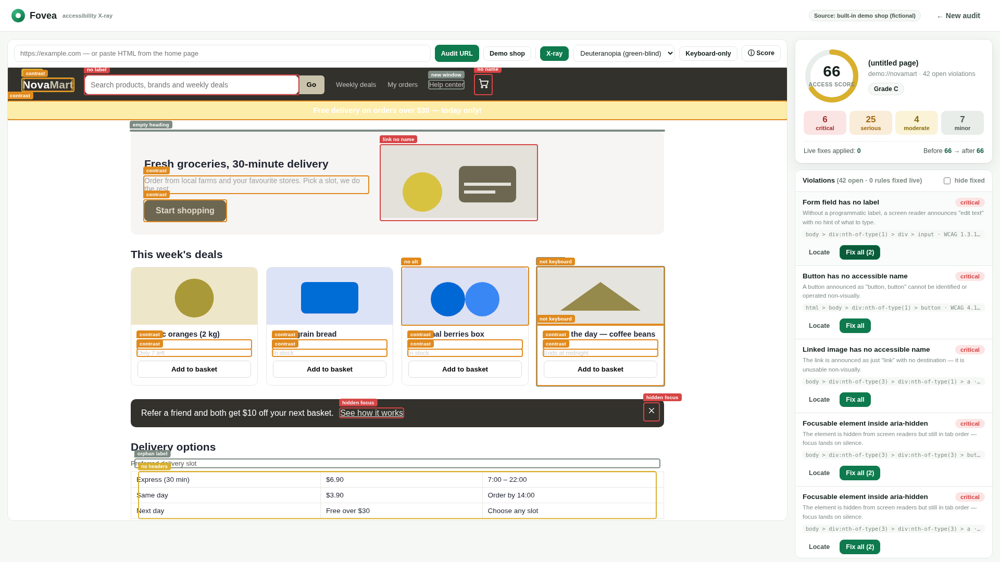
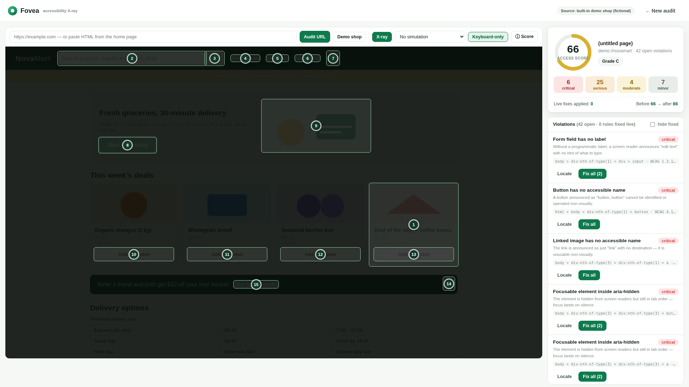
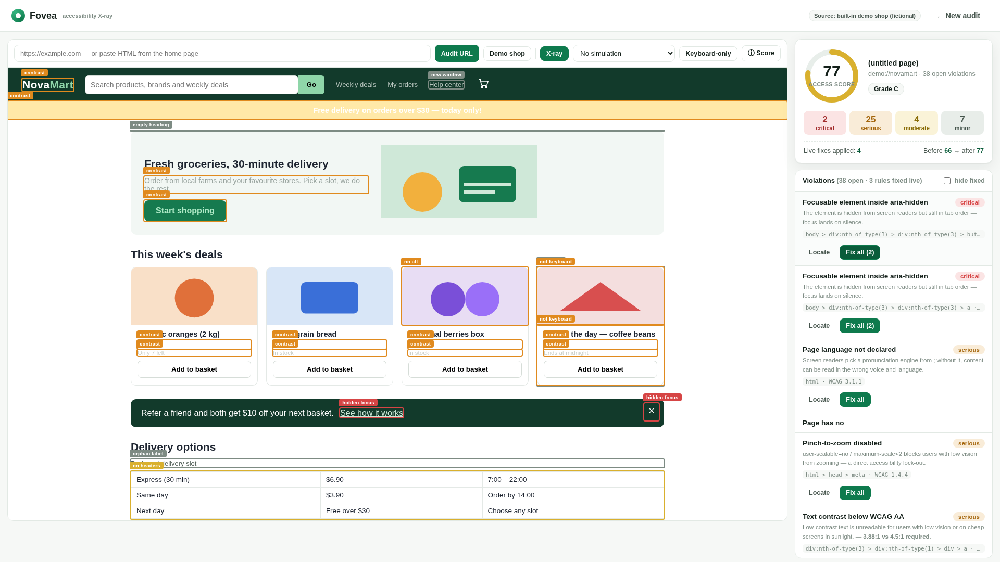

# Fovea

### The accessibility X-ray for the web

Fovea makes accessibility failures visible on the page where they happen—and lets you fix them live.

<p align="center">
  
</p>

<p align="center">
  <a href="https://youtu.be/dn-q3wNH4-8"><strong>Watch the 2:47 product demo</strong></a>
  ·
  <a href="#quick-start">Run it locally</a>
  ·
  <a href="#how-it-works">See how it works</a>
</p>

> Accessibility tooling usually gives you a report. Fovea gives you a point of view: the real element, the reason it fails, the user impact, and a live before/after fix loop.

## Why Fovea exists

Accessibility problems are easy to miss when you inspect a page only as a developer. A low-contrast label can look acceptable on your monitor. An unnamed button works perfectly with a mouse. A broken keyboard path remains invisible until someone depends on it.

Fovea turns those invisible failures into an explorable interface. Open the built-in demo shop or audit a URL, then inspect the page through the lens of contrast, color vision, keyboard navigation, reading order, and assistive-technology naming.

## What it does

- **X-rays the real page** — pins findings directly to live elements, including contrast, labels, names, focus order, headings, duplicate IDs, zoom settings, and other WCAG 2.2-aligned checks.
- **Simulates user perspectives** — explore protanopia, deuteranopia, tritanopia, and low-vision tunnel vision with color-science matrices rather than a simple hue rotation.
- **Reveals keyboard access** — dims the page and renders the actual tab path with numbered focus stops.
- **Builds a reading-order transcript** — shows the content and accessible names a user agent is likely to encounter.
- **Fixes findings live** — apply a rule to the sandboxed copy, re-scan it, watch the Access Score change, and copy the suggested fix into your real code.
- **Audits at scale** — reuse the same engine in the headless crawler to fetch, rewrite, render, analyze, and aggregate a corpus of homepages.
- **Stays local and deterministic** — no accounts, API keys, telemetry, or AI calls in the audit loop.

## See it in action

| X-ray overlay | Color and low-vision simulation |
| --- | --- |
|  |  |

| Keyboard path | Live fix mode |
| --- | --- |
|  |  |

**[Watch the full demo on YouTube →](https://youtu.be/dn-q3wNH4-8)**

## Quick start

### Requirements

- Node.js **20 or newer**
- npm

### Run locally

```bash
git clone https://github.com/Tulip9ZZZA/fovea.git
cd fovea
npm install
npm start
```

Open [http://localhost:3000](http://localhost:3000), then choose **Audit the demo shop** or paste a URL.

Fovea has no required environment variables and no `.env` setup. The server uses `PORT` when provided and defaults to `3000`.

## Development commands

```bash
npm test          # 39 deterministic engine unit tests
npm run test:e2e  # Playwright browser tests
npm run crawl     # rebuild the committed corpus report
```

The browser tests and crawler require a Playwright browser installation. If Chromium is not already available:

```bash
npx playwright install chromium
```

## How it works

```text
URL ──► SSRF-guarded same-origin proxy
          │  fetches HTML, strips scripts, rewrites assets
          ▼
      sandboxed iframe
          │
          ▼
      scanner.js ──► element snapshots
          │           tag, attributes, geometry, styles,
          │           visibility, backgrounds, accessible context
          ▼
      pure audit engine
          ├── rules.js          WCAG-aligned rule checks
          ├── color.js          luminance, contrast, compositing
          ├── taborder.js       keyboard focus order
          ├── readingorder.js   transcript order and naming
          ├── score.js          deterministic Access Score
          └── sim.js            color-vision simulation matrices
          ▼
      X-ray · simulations · keyboard path · transcript · live fixes
          │
          ▼
      bin/crawl.js ──► committed corpus summary and report
```

The engine is intentionally made of pure, testable functions. The same logic can run in the browser, in Node unit tests, and in the headless crawler.

### Access Score

The score starts at 100 and applies weighted deductions for open violations. Weighting considers severity, scope, and repeated instances of the same rule. It is a deterministic triage signal—not a WCAG certification—and the app's score explanation describes how each term contributes.

## Project map

```text
src/
├── engine/       Pure audit engine: rules, color, score, tab order, reading order, simulations
├── index.html    Landing page
├── workspace.*   Interactive audit workspace
└── batch.*       Corpus report UI

server.js         Express server, static app, demo routes, proxy, corpus API
lib/proxy.js      Same-origin fetch proxy with SSRF protections
bin/crawl.js      Headless corpus pipeline
demo/             Fictional NovaMart storefront with seeded failures
data/corpus/     Committed corpus results
scripts/          Screenshot and demo automation
tests/            Unit and Playwright end-to-end tests
docs/             Screenshots, demo script, voiceover, and supporting material
```

## Honest scope

Fovea is designed to make a meaningful, inspectable slice of accessibility easier to understand. It is not a conformance certification tool.

- Audits cover static markup and computed styles. Audited scripts are stripped; client-rendered states are out of scope for the proxy path.
- Paste-HTML mode is available when you need to inspect markup directly.
- Disability simulations are awareness aids, not clinical tools.
- The transcript is a reading-order estimate, not a replacement for testing with a screen reader.
- Live Fix Mode edits only the in-memory sandbox. Use the generated snippets in your real code.
- The rule set is deliberately documented in the app's About panel and source rather than presented as universal coverage.

## Technical notes

- Node.js and Express
- Browser UI with vanilla HTML, CSS, and JavaScript
- Playwright for browser automation and end-to-end coverage
- WCAG luminance and contrast calculations with published golden-value tests
- Color-vision simulation matrices based on Machado, Oliveira & Fernandes (2009)
- No runtime AI dependency

Design decisions and deliberate limitations live in [DECISIONS.md](DECISIONS.md). Third-party attributions and dependency licenses live in [CREDITS.md](CREDITS.md). Compliance evidence is collected in [compliance/](compliance/).

## Contributing

Issues and pull requests are welcome. Before opening a change:

1. Install dependencies with `npm install`.
2. Run `npm test`.
3. Run the relevant Playwright tests when changing browser behavior.
4. Keep changes focused and explain the user-facing impact in the pull request.

Please avoid presenting Fovea as a certification or adding claims that cannot be reproduced from the repository.

## How AI was used

Fovea was built during Next Byte Hacks V5 with AI coding agents. The team specified the architecture, reviewed the files, and tested the implementation before landing changes. The rule logic, color math, scoring, and UI are original work in this repository; the project's disclosure and supporting evidence are documented in [devpost.md](devpost.md) and [compliance/](compliance/).

## License

Released under the [MIT License](LICENSE). Built during Next Byte Hacks V5, October–November 2026.
